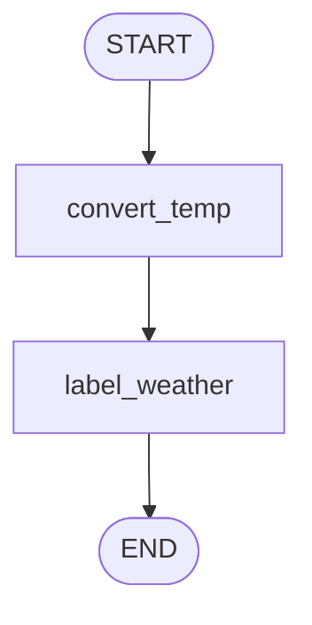
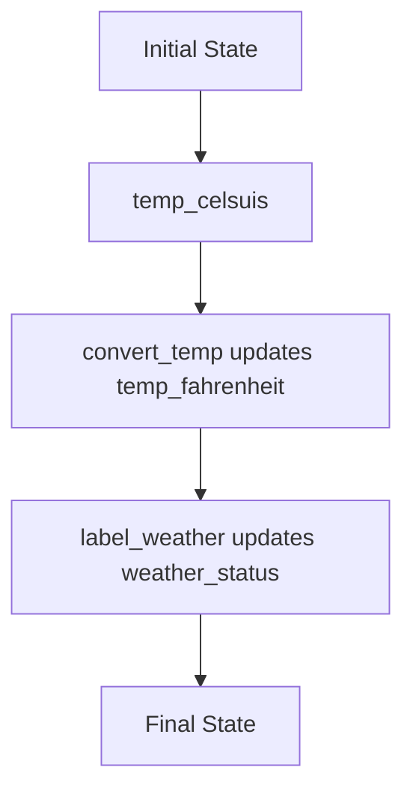
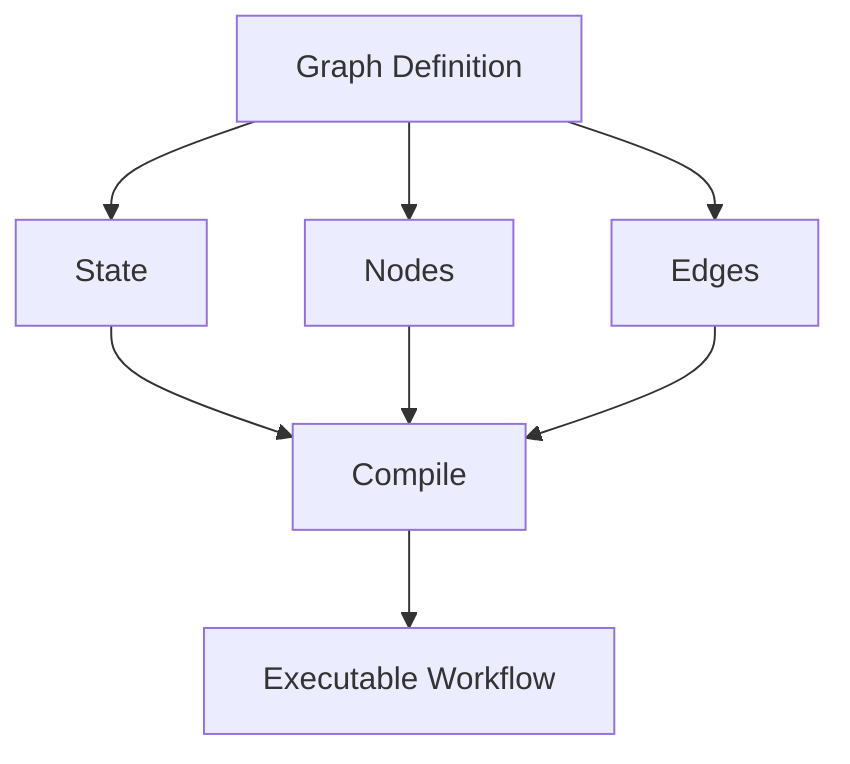
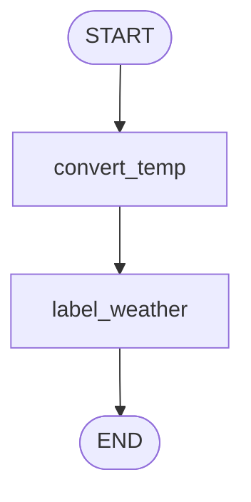
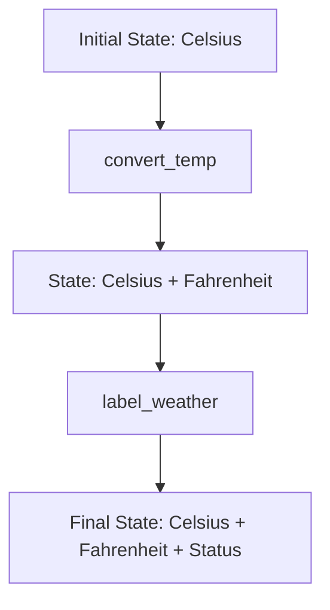

# LangGraph – Sequential Workflow (SOP)

## 1. Objective

This project demonstrates how to build a **Sequential Workflow using LangGraph**.

We will build a workflow that:

1. Accepts a temperature in Celsius.
2. Converts Celsius into Fahrenheit.
3. Classifies the Fahrenheit temperature into a weather category.

This project helps understand the core building blocks of LangGraph:

- State
- Nodes
- Edges
- START
- END
- StateGraph
- Graph compilation
- Graph execution
- Graph visualization

---

## 2. Use Case – Temperature Conversion and Weather Classification

### Input

- Temperature in Celsius: `28.5`

### Processing

**Node 1: `convert_temp`**

Converts Celsius into Fahrenheit.

Formula:

\[
F = (C \times \frac{9}{5}) + 32
\]

**Node 2: `label_weather`**

Classifies the temperature based on the Fahrenheit value.

| Fahrenheit temperature | Weather status |
|---|---|
| Less than 50°F | Cold |
| 50°F to less than 77°F | Mild |
| 77°F to less than 95°F | Hot |
| 95°F and above | Extreme Hot |

### Expected output

```python
{
    'temp_celsuis': 28.5,
    'temp_fahrenheit': 83.3,
    'weather_status': 'Hot'
}
```

---

## 3. Workflow Architecture

### Sequential workflow diagram



### Workflow execution

| Step | Component | Responsibility |
|---|---|---|
| 1 | START | Begins workflow execution |
| 2 | `convert_temp` | Converts Celsius to Fahrenheit |
| 3 | `label_weather` | Classifies Fahrenheit temperature |
| 4 | END | Terminates the workflow |

<text color="success" weight="medium">This is a sequential workflow because nodes execute one after another in a predefined order.</text>

---

## 4. Project Folder Structure

Create a folder named `Sequential Workflow`.

```text
Sequential Workflow/
│
├── .langgraphtest/
├── main.py
├── requirements.txt
└── .gitignore
```

| File/Folder | Purpose |
|---|---|
| `.langgraphtest` | Python virtual environment |
| `main.py` | Contains LangGraph workflow implementation |
| `requirements.txt` | Contains project dependencies |
| `.gitignore` | Prevents unnecessary files from being uploaded to GitHub |

---

## 5. Step 1 – Create the Project Folder

Open Command Prompt.

Navigate to your LangGraph directory:

```cmd
cd C:\Users\pushpitha\Desktop\LangGraph
```

Create a project folder:

```cmd
mkdir "Sequential Workflow"
```

Navigate inside the folder:

```cmd
cd "Sequential Workflow"
```

---

## 6. Step 2 – Create a Python Virtual Environment

A virtual environment isolates project dependencies from other Python projects.

Create the virtual environment:

```cmd
python -m venv .langgraphtest
```

### Activate the virtual environment

For Windows Command Prompt:

```cmd
.\.langgraphtest\Scripts\activate.bat
```

After activation, you should see:

```text
(.langgraphtest) C:\Users\pushpitha\Desktop\LangGraph\Sequential Workflow>
```

---

## 7. Step 3 – Create requirements.txt

Create a file named `requirements.txt`.

Add the following dependencies:

```text
langgraph
langchain-openai
python-dotenv
```

### Dependency explanation

| Dependency | Purpose |
|---|---|
| `langgraph` | Creates, connects, compiles and executes graph-based workflows |
| `langchain-openai` | Integration with OpenAI models |
| `python-dotenv` | Loads environment variables from `.env` files |

<text color="secondary">The current workflow does not require an LLM or API key. These dependencies can be reused when extending the project into LLM-based workflows.</text>

### Install the dependencies

```cmd
pip install -r requirements.txt
```

---

## 8. Step 4 – Create main.py

Create a file named `main.py`.

We will implement the complete workflow in this file.

### 8.1 Import the required modules

```python
from langgraph.graph import StateGraph, START, END
from typing import TypedDict
```

| Component | Purpose |
|---|---|
| `StateGraph` | Creates a graph-based workflow |
| `START` | Represents the starting point |
| `END` | Represents the termination point |
| `TypedDict` | Defines the expected structure of the state |

---

### 8.2 Define the State

```python
class TemperatureState(TypedDict):
    temp_celsuis: float
    temp_fahrenheit: float
    weather_status: str
```

### What is State?

State is the shared data structure that flows through the workflow.

In our project, state contains three variables.

| Variable | Data type | Purpose |
|---|---|---|
| `temp_celsuis` | `float` | Stores the input Celsius temperature |
| `temp_fahrenheit` | `float` | Stores the converted Fahrenheit temperature |
| `weather_status` | `str` | Stores the weather classification |

### Why do we need State?

Our workflow contains two nodes.

- `convert_temp` needs the Celsius value and updates Fahrenheit.
- `label_weather` needs the Fahrenheit value and updates the weather status.

Both nodes operate on the shared state.



---

### 8.3 Create the First Node – convert_temp

```python
def convert_temp(state: TemperatureState) -> TemperatureState:

    celsius = state['temp_celsuis']

    fahrenheit = (celsius * 9/5) + 32

    state['temp_fahrenheit'] = round(fahrenheit, 2)

    return state
```

### What is a Node?

A node is a Python function that performs a specific task inside the LangGraph workflow.

Here, `convert_temp` is the first node.

### Node execution logic

1. Receive the state.
2. Read `temp_celsuis`.
3. Calculate Fahrenheit.
4. Update `temp_fahrenheit`.
5. Return the updated state.

### Conversion formula

\[
F = (C \times \frac{9}{5}) + 32
\]

Example:

\[
C = 28.5
\]

\[
F = (28.5 \times \frac{9}{5}) + 32
\]

\[
F = 83.3
\]

### State before this node

```python
{
    'temp_celsuis': 28.5
}
```

### State after this node

```python
{
    'temp_celsuis': 28.5,
    'temp_fahrenheit': 83.3
}
```

The first node adds the converted temperature to the state.

---

### 8.4 Create the Second Node – label_weather

```python
def label_weather(state: TemperatureState) -> TemperatureState:

    fahrenheit = state['temp_fahrenheit']

    if fahrenheit < 50:
        state['weather_status'] = "Cold"

    elif fahrenheit < 77:
        state['weather_status'] = "Mild"

    elif fahrenheit < 95:
        state['weather_status'] = "Hot"

    else:
        state['weather_status'] = "Extreme Hot"

    return state
```

### What is label_weather?

`label_weather` is the second node in our workflow.

It receives the state produced by the first node and categorizes the temperature based on the Fahrenheit value.

### Classification logic

| Condition | Status |
|---|---|
| `fahrenheit < 50` | Cold |
| `fahrenheit < 77` | Mild |
| `fahrenheit < 95` | Hot |
| Otherwise | Extreme Hot |

### Why use elif?

We use `elif` to evaluate multiple conditions in sequence.

Python checks the conditions from top to bottom.

For example, if the Fahrenheit temperature is `83.3`:

- Is it less than 50? No.
- Is it less than 77? No.
- Is it less than 95? Yes.

Therefore:

```python
state['weather_status'] = "Hot"
```

### State received by this node

```python
{
    'temp_celsuis': 28.5,
    'temp_fahrenheit': 83.3
}
```

### State after this node

```python
{
    'temp_celsuis': 28.5,
    'temp_fahrenheit': 83.3,
    'weather_status': 'Hot'
}
```

The second node adds the weather classification to the state.

---

## 9. Step 5 – Define the Graph

```python
graph = StateGraph(TemperatureState)
```

### What is StateGraph?

`StateGraph` is the graph builder that defines how our workflow operates using a shared state.

We pass `TemperatureState` so that the graph knows the structure of the state being used in the workflow.

---

## 10. Step 6 – Add Nodes to the Graph

```python
graph.add_node("convert_temp", convert_temp)

graph.add_node("label_weather", label_weather)
```

### What is add_node()?

`add_node()` registers a Python function as a node in the graph.

Syntax:

```python
graph.add_node("node_name", python_function)
```

| Node name | Function | Responsibility |
|---|---|---|
| `convert_temp` | `convert_temp` | Celsius to Fahrenheit |
| `label_weather` | `label_weather` | Temperature classification |

We now have two nodes registered in the graph.

---

## 11. Step 7 – Add Edges to the Graph

```python
graph.add_edge(START, 'convert_temp')

graph.add_edge('convert_temp', 'label_weather')

graph.add_edge('label_weather', END)
```

### What are Edges?

Edges define how execution moves between nodes.

| Edge | Purpose |
|---|---|
| `START → convert_temp` | Starts execution at the conversion node |
| `convert_temp → label_weather` | Moves to the weather classification node |
| `label_weather → END` | Terminates the workflow |

### Workflow connection


The edges establish a sequential execution path.

---

## 12. Step 8 – Compile the Graph

```python
workflow = graph.compile()
```

### What is Compilation?

Compilation transforms the graph definition into an executable workflow.

Before compilation, we define:

- State
- Nodes
- Edges

After compilation, the workflow can be executed using `invoke()`.



---

## 13. Step 9 – Define the Initial State

```python
initial_state = {
    'temp_celsuis': 28.5
}
```

The initial state contains the input data required to execute the workflow.

We provide only the Celsius value because the other values are generated by the nodes.

---

## 14. Step 10 – Invoke the Workflow

```python
final_state = workflow.invoke(initial_state)

print(final_state)
```

### What is invoke()?

`invoke()` executes the compiled workflow using the provided input state.

### Execution flow

1. The workflow receives the initial state.
2. `START` directs execution to `convert_temp`.
3. `convert_temp` calculates Fahrenheit.
4. The updated state is passed to `label_weather`.
5. `label_weather` classifies the temperature.
6. The workflow reaches `END`.
7. The final state is returned.

### Expected output

```python
{
    'temp_celsuis': 28.5,
    'temp_fahrenheit': 83.3,
    'weather_status': 'Hot'
}
```

---

## 15. Step 11 – Visualize the Graph

Graph visualization helps us understand the workflow structure.

### Option 1 – Print Mermaid diagram

```python
print(workflow.get_graph().draw_mermaid())
```

This displays the graph structure as Mermaid text.

### Option 2 – Generate a PNG image

```python
from IPython.display import Image, display

display(Image(workflow.get_graph().draw_mermaid_png()))
```

<text color="secondary">The IPython display approach is suitable for Jupyter Notebook or IPython environments. In standard Command Prompt execution, print the Mermaid diagram or save the generated PNG to a file and open it separately.</text>

### Visual representation



---

## 16. Complete Code – main.py

```python
from langgraph.graph import StateGraph, START, END
from typing import TypedDict


# Define the state
class TemperatureState(TypedDict):
    temp_celsuis: float
    temp_fahrenheit: float
    weather_status: str


# Define the first node
def convert_temp(state: TemperatureState) -> TemperatureState:

    celsius = state['temp_celsuis']

    fahrenheit = (celsius * 9/5) + 32

    state['temp_fahrenheit'] = round(fahrenheit, 2)

    return state


# Define the second node
def label_weather(state: TemperatureState) -> TemperatureState:

    fahrenheit = state['temp_fahrenheit']

    if fahrenheit < 50:
        state['weather_status'] = "Cold"

    elif fahrenheit < 77:
        state['weather_status'] = "Mild"

    elif fahrenheit < 95:
        state['weather_status'] = "Hot"

    else:
        state['weather_status'] = "Extreme Hot"

    return state


# Define the graph
graph = StateGraph(TemperatureState)


# Add nodes
graph.add_node("convert_temp", convert_temp)
graph.add_node("label_weather", label_weather)


# Add edges
graph.add_edge(START, 'convert_temp')
graph.add_edge('convert_temp', 'label_weather')
graph.add_edge('label_weather', END)


# Compile the graph
workflow = graph.compile()


# Define initial state
initial_state = {
    'temp_celsuis': 28.5
}


# Execute the workflow
final_state = workflow.invoke(initial_state)


# Print the final state
print(final_state)


# Visualize the graph
print(workflow.get_graph().draw_mermaid())
```

---

## 17. Step 12 – Execute the Project

Make sure the virtual environment is activated.

Run:

```cmd
python main.py
```

### Expected output

```text
{'temp_celsuis': 28.5, 'temp_fahrenheit': 83.3, 'weather_status': 'Hot'}
```

---

## 18. Step 13 – Create .gitignore

Create a file named `.gitignore`.

```gitignore
.langgraphtest/
__pycache__/
*.pyc
.env
.ipynb_checkpoints/
```

### Why .gitignore?

It prevents unnecessary files and sensitive information from being uploaded to GitHub.

| File/Folder | Purpose |
|---|---|
| `.langgraphtest/` | Prevents uploading the virtual environment |
| `__pycache__/` | Prevents uploading Python cache files |
| `*.pyc` | Prevents uploading compiled Python files |
| `.env` | Prevents uploading secrets and API keys |
| `.ipynb_checkpoints/` | Prevents uploading notebook checkpoint files |

---

## 19. Step 14 – Upload to GitHub

### Initialize Git

```cmd
git init
```

### Add files

```cmd
git add .
```

### Commit changes

```cmd
git commit -m "Build sequential temperature workflow"
```

### Create a GitHub repository

1. Open GitHub.
2. Create a new repository.
3. Repository name: `langgraph-sequential-workflow`.
4. Choose Public or Private.
5. Create the repository.

### Connect the local repository to GitHub

Replace `USERNAME` with your GitHub username.

```cmd
git remote add origin https://github.com/USERNAME/langgraph-sequential-workflow.git
```

### Push to GitHub

```cmd
git branch -M main
git push -u origin main
```

---

## 20. How the State Changes Throughout the Workflow

### Step 1 – Initial State

```python
{
    'temp_celsuis': 28.5
}
```

The workflow receives Celsius as input.

### Step 2 – After convert_temp

```python
{
    'temp_celsuis': 28.5,
    'temp_fahrenheit': 83.3
}
```

The first node converts Celsius into Fahrenheit.

### Step 3 – After label_weather

```python
{
    'temp_celsuis': 28.5,
    'temp_fahrenheit': 83.3,
    'weather_status': 'Hot'
}
```

The second node classifies the temperature.

### State transformation



---

## 21. Connecting the Dots – Why Each Component Exists

| Component | Problem it solves |
|---|---|
| State | Allows nodes to share and update workflow data |
| TypedDict | Defines the structure of the state |
| Node | Separates tasks into reusable functions |
| START | Defines where workflow execution begins |
| Edge | Defines the execution path |
| END | Defines where workflow execution terminates |
| StateGraph | Builds a state-driven graph |
| Compile | Creates an executable workflow |
| Invoke | Runs the workflow |
| Graph visualization | Helps understand workflow architecture |

---

## 22. Why This is a Sequential Workflow

This is a sequential workflow because tasks execute one after another.

```text
START
  |
  v
convert_temp
  |
  v
label_weather
  |
  v
END
```

There is:

- No conditional routing between nodes.
- No parallel execution.
- No looping.
- No agent decision-making.

The execution path is predefined through edges.

<text color="success" weight="medium">Each node has a specific responsibility, and the shared state carries the information from one node to the next.</text>

---

## 23. Future Learning – Extend This Workflow

| Next concept | What you will learn |
|---|---|
| Multiple sequential nodes | Build longer workflows |
| Conditional edges | Route execution based on conditions |
| Loops | Repeat nodes until a condition is met |
| Parallel workflows | Execute multiple tasks simultaneously |
| Checkpointing | Persist workflow execution state |
| Human-in-the-loop | Add human approval into workflows |
| Agent workflows | Build decision-making AI workflows |
| LLM integration | Connect nodes with Gemini or OpenAI |
| RAG workflows | Build document retrieval pipelines |

---

## 24. Quick Reference – Rebuild from Scratch

```cmd
mkdir "Sequential Workflow"
cd "Sequential Workflow"

python -m venv .langgraphtest

.\.langgraphtest\Scripts\activate.bat

pip install -r requirements.txt

python main.py
```

---

## 25. Key Takeaway

We built a two-node sequential workflow using LangGraph.

**Node 1 – `convert_temp`**

Converts Celsius into Fahrenheit.

**Node 2 – `label_weather`**

Classifies the converted Fahrenheit temperature.

Both nodes operate on shared state, and the graph defines the order of execution.

The workflow follows:


This is the foundation for more advanced LangGraph workflows such as:

- Multi-step AI workflows
- RAG pipelines
- LLM-based classification workflows
- Tool-using agents
- Human-in-the-loop systems
- Enterprise agentic AI applications

---

**Documentation purpose:** Personal SOP, repeatable setup guide, learning reference and future revision documentation.

